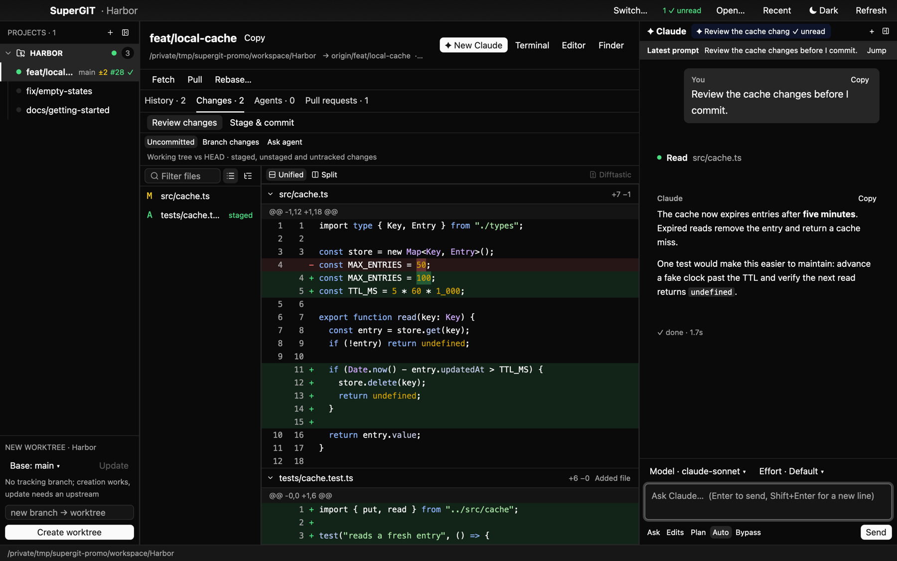

<p align="center">
  
</p>

<h1 align="center">SuperGIT</h1>

<p align="center"><strong>One window for your worktrees, agents, and pull requests.</strong></p>

<p align="center">
  A native Git client for macOS and Linux, built for working on several branches with Claude Code and Codex.
</p>

<p align="center">
  <a href="https://github.com/Aitem/SuperGIT/releases">Releases</a> ·
  <a href="#get-started">Get started</a> ·
  <a href="https://github.com/Aitem/SuperGIT/issues">Issues</a>
</p>



[Watch the SuperGIT demo ↗](assets/media/supergit-demo.mp4)

## From worktree to review

| When you need to… | In SuperGIT |
| --- | --- |
| **Work on several branches** | Give each branch its own worktree. Switch projects and see the branch status, PR, and agent activity in the sidebar. |
| **Review exactly what goes into a commit** | Compare staged and unstaged changes, stage a file or a single hunk, then commit, amend, or squash a run of local commits. |
| **Give an agent the right context** | Send a file or hunk to Claude Code or Codex. Pick the model and reasoning effort, inspect tool diffs, and answer approval prompts in the chat. Each worktree keeps its own conversations. |
| **Sync a branch** | Fetch remote refs, pull its upstream by fast-forward, or preview a rebase onto a local branch. |
| **Review a GitHub PR** | Read the conversation, commits, checks, and changed files. Jump from a review thread to the exact line, check out the PR in a worktree, or merge it from the app. |

## Get started

You’ll need **Git**. For GitHub pull requests, install the [GitHub CLI](https://cli.github.com/) and run `gh auth login`. Native chats use your existing [Claude Code](https://code.claude.com/docs/en/quickstart) or [Codex CLI](https://developers.openai.com/codex/cli) installation and sign-in.

Download packages from [GitHub Releases](https://github.com/Aitem/SuperGIT/releases). Choose the Apple Silicon app ZIP on macOS or the matching binary archive on Linux.

For builds from source, install [Rustup](https://rustup.rs/). The repository pins its Rust toolchain.

**macOS** · Build and install `SuperGIT.app` in Applications.

```sh
scripts/bundle-macos.sh --install
```

**Linux** · Install the binary and desktop launcher for the current user. The app uses the system’s Wayland or X11, `libxkbcommon`, Vulkan drivers, and fontconfig.

```sh
scripts/install-linux.sh
```

Open SuperGIT from the launcher or point the CLI at any worktree:

```sh
supergit ~/work/my-project
```

### Shortcuts worth learning

| Action | macOS | Linux |
| --- | --- | --- |
| Jump to a project, worktree, PR, or conversation | ⌘ P | Ctrl P |
| Toggle the chat | ⌘ L | Ctrl L |
| Start a conversation in the selected worktree | ⌘ N | Ctrl N |
| Refresh | ⌘ R | Ctrl R |
| Open a repository | ⌘ O | Ctrl O |

## Built with Rust and GPUI

SuperGIT uses your local Git CLI and its repository configuration. Claude Code and Codex conversations are ordinary provider sessions you can resume from the app or a terminal. Unified and split diffs are built in, with optional structural diffs through [Difftastic](https://difftastic.wilfred.me.uk/).

See the [developer notes](CLAUDE.md) for build and test commands and the [roadmap](docs/ROADMAP.md) for what’s next.

[MIT License](LICENSE)
